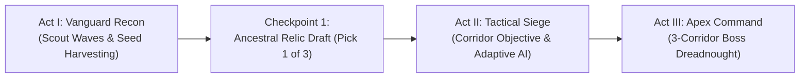

<!--
  Copyright 2026 Void Sower Authors.

  Licensed under the Apache License, Version 2.0 (the "License");
  you may not use this file except in compliance with the License.
  You may obtain a copy of the License at

      http://www.apache.org/licenses/LICENSE-2.0

  Unless required by applicable law or agreed to in writing, software
  distributed under the License is distributed on an "AS IS" BASIS,
  WITHOUT WARRANTIES OR CONDITIONS OF ANY KIND, either express or implied.
  See the License for the specific language governing permissions and
  limitations under the License.
-->

# 🌌 Void Sower: How to Play, What to Expect & Master Strategy Guide

Welcome, Commander. **Void Sower** is an Afrofuturist 3D tactical space shooter that fuses real-time orbital flight with the deep mathematical strategy of four classic African board games:
- **Bao la Kiswahili** (*Swahili Coast* — Count-and-Capture Seed Sowing & Quadratic $M^2$ Capacitors)
- **Morabaraba** (*Southern Africa* — 3-in-a-Row Laser Fence & 1.5x Triad Super-Beam Barrages)
- **Fanorona** (*Madagascar* — Forward Approach & Backward Withdrawal Vector Strikes)
- **Yoté** (*West Africa* — High-Value Cruiser Capture & Free 800 DMG Orbital Surgical Culls)

Every offensive beam in Void Sower is **100% player-triggered**—you cannot clear a sector passively. Victory requires active 3D piloting, deliberate seed harvesting, and smart tactical timing.

---

## 1. What to Expect: The 3-Act Story Mission Structure

Every sector across all **3 Campaign Operations (27 Sectors total)** unfolds as an interactive **3-Act Story Mission** guided by live holographic transmissions at the top of your 3D viewport:

### Act I · `PHASE I · VANGUARD RECON`
- **What Happens**: Hegemony scout formations warp into the upper orbital lanes (`Corridors 1–8`). Live holographic comms from **Admiral Zawadi**, **Strategist Andriana**, or **Elder Nommo-7** brief you on the sector's lore target.
- **Your Goal**: Pilot the Olympus Dreadnought across the lanes, use **`BLASTER FIRE`** to pick off scouts and harvest plasma seeds, and build up charge across your 8 frontline Totem bays.

### Checkpoint 1 · Ancestral Relic Draft (`RELIC:`)
- **What Happens**: Once the Vanguard wave is broken, a live 3-choice **Ancestral Relic Draft bar** appears at the top of the combat viewport without interrupting your flight flow.
- **Your Goal**: Tap 1 of the 3 offered relics (`SowingMutation`) to permanently augment your ship for the rest of the sector (e.g., boosted Particle Lance damage, extra Core Siphon per kill, or amplified Flak blast radius).

### Act II · `PHASE II · TACTICAL SIEGE`
- **What Happens**: Heavier **Armored Cruisers** and **Adaptive Evasive Interceptors** drop into orbit while an active **Tactical Corridor Objective** initiates (`Outpost Reclamation`, `Warp Rift Collapse`, `Convoy Escort`, or `Asteroid Prospecting`).
- **Your Goal**: Complete the corridor objective to `100%` while countering enemies that actively read your bay charges and steer away from your `2+` seed Super-Beam lanes. Shatter Armored Cruisers to bank **Yoté Surgical Cull** charges for the Boss!

### Act III · `PHASE III · APEX COMMAND`
- **What Happens**: A massive **Hegemony Apex Command Dreadnought** warps in, spanning multiple corridors with regenerating multi-layer shields.
- **Your Goal**: Single-core blaster shots will barely scratch an Apex Flagship. Link a **Morabaraba 3-in-a-Row Laser Fence** (`1.5x` 3-corridor barrage), sow high-mass quadratic cascades ($M \ge 4 \implies 1,600+\text{ DMG}$), and trigger banked **Yoté Surgical Culls** (`800 DMG`) to collapse the Boss's shields and liberate the sector.

---

## 2. Controls, 3D Flight & The Totem Command Bar

All interactive controls are engineered for ergonomic **one-thumb portrait play** in the lower 30% of the screen, while the **3D Perspective Flight Camera** automatically pitches and banks in real time as you fly.

### 2.1 3D Ship Flight & Automatic Banking Camera
- **Drag anywhere in the 3D Arena** to pilot the Olympus Dreadnought horizontally across **Corridors 1–8** and forward/backward in orbital depth:
  - **Rear Defense Shelf (`y = 0.15`)**: Safe reaction time to intercept falling enemy plasma bombs (`1.0x` base damage).
  - **Vanguard Forward Surge (`y up to 0.65`)**: Flying forward into the enemy's teeth pitches the 3D camera into an aggressive pursuit angle and boosts all weapon damage up to **`1.6x`**!
- **Automatic 3D Camera**: There are no manual camera buttons to fumble with—banking left/right or thrusting forward smoothly tilts and pitches the 3D viewport automatically.

### 2.2 The 8 Frontline 3D Totems & 4 Charge Tiers
Eight 3D Ancestral Totems sit along your defense perimeter (corresponding to Frontline Bays `8–15` across Corridors `1–8`). Each Totem's power grows as it accumulates glowing plasma seeds (`● ● ○ ○`):

| Seed Count ($M$) | HUD Label | Defensive Role | Offensive Power When Player Fires ($D = 100 \cdot M^2$) |
| :---: | :---: | :--- | :--- |
| **0 Seeds** (`○○○○`) | `EMPTY` | Vulnerable! Enemy bomb hits cause an **EMP Breach (`-1 CORE`)**. | Baseline **`BLASTER FIRE`** (`100 DMG`, spends 1 Core). |
| **1 Seed** (`●○○○`) | `SHIELD` | **Blocks Bombs (`DEFLECT +50`)** without losing reactor cores. | `100 DMG` Particle Lance. |
| **2–3 Seeds** (`●●○○`) | `SUPER BEAM` | Blocks bombs + can link into a **3-in-a-Row Laser Fence**. | **`400 DMG`** ($M=2$) or **`900 DMG`** ($M=3$) Super Beam on tap! |
| **4+ Seeds** (`●●●●`) | `MEGA GUN` | Maximum shield + Laser Fence anchor. | **`1,600 DMG`** ($M=4$) up to **`6,400+ DMG`** ($M=8$) Mega Beam! |

> [!IMPORTANT]
> **Frontline Totems Never Auto-Fire Passively:** Charged Totems (`2+` seeds) hold their stored $M^2$ capacitor energy and protect your lane until **you** command them to fire (by tapping the center Totem pill, tapping `FENCE BLAST`, or landing a `‹ SOW` / `SOW ›` cascade on that lane).

### 2.3 The Bottom Martial Command Bar
At the bottom of the screen sits the compact 3-part command bar:
1. **`[ ‹ SOW ]` & `[ SOW › ]` (Left Pills — Spread Seeds)**:
   - Scoops all seeds from your currently aligned Totem bay (plus 1 core from reserves) and deals them one-by-one Left (`‹ SOW`) or Right (`SOW ›`) around the 16-bay ring.
   - If the **last seed** lands in a frontline lane with an enemy, that Totem **immediately fires** its full quadratic $M^2$ beam AND harvests `+2` bonus seeds (*Bao Mtaji* capture)!
2. **`[ TOTEM #X • LEVEL ●●○○ ]` (Center Pill — One-Tap Super Beam)**:
   - Displays your active corridor's Totem level and 4 visual seed pips.
   - When charged with **`2+` seeds**, tap this center pill to **instantly unleash that Totem's stored $M^2$ Super Beam** up the active corridor!
3. **`[ BLASTER FIRE ]` / `[ FENCE BLAST ]` (Right Pill — Primary Trigger)**:
   - **Normal State (`BLASTER FIRE`)**: Fires a rapid pulse up your active corridor. Every **2 blaster hits** (or any enemy kill) triggers **Shoot-to-Harvest**, sowing glowing plasma seeds into your Totem ring!
   - **Triad State (`FENCE BLAST`)**: When 3 adjacent Totems have `2+` seeds each, this button turns gold (`FENCE BLAST`)—tapping it unleashes a simultaneous **3-Corridor `1.5x` Morabaraba Super-Beam Barrage**!

---

## 3. Master Strategy Guide: How to Win & Earn 3 Stars

### Strategy 1: The "Shoot-to-Harvest $\to$ Sow $\to$ Super Beam" Loop
Never spam single-seed `BLASTER FIRE` shots at heavy Cruisers or Bosses—you will burn through your finite reactor cores for only `100 DMG` per shot. Instead:
1. **Harvest**: Use 2–3 quick `BLASTER FIRE` shots on weak Escort drones to trigger **Shoot-to-Harvest** and grow adjacent Totems to `2–3` seeds.
2. **Consolidate (`‹ SOW` / `SOW ›`)**: Follow the golden **`💡 TIP: TAP SOW › TO POWER UP TOTEM #X`** advisory at the bottom of the dock (or swipe left/right) to cascade seeds into a `4+` seed **MEGA GUN** (`1,600+ DMG`).
3. **Unleash**: Tap the center Totem pill or land a sowing cascade on the enemy's corridor to vaporize entire formations in a single shot.

### Strategy 2: Build the Morabaraba "3-in-a-Row Laser Fence" Early
 whenever three adjacent frontline Totems (`e.g., Totems #3, #4, #5`) each hold **`2+` seeds**:
- A golden **3D Laser Fence** automatically spans those 3 corridors, **zapping all incoming enemy plasma bombs mid-air (`+50 PTS`)** without consuming your seeds.
- Wait until multiple heavy enemies or the Act III Apex Boss enter those 3 lanes, then tap **`FENCE BLAST`** to fire all 3 Totems simultaneously with a **`1.5x` Triad Damage Multiplier**!

### Strategy 3: Master Fanorona Forward & Backward Vector Strikes
Your ship's vertical movement (`Y` depth) is a weapon:
- **Fanorona Approach Strike**: Rapidly thrust your Dreadnought **forward** (`upward`) in a corridor containing enemies to trigger a piercing kinetic surge that damages aligned targets.
- **Fanorona Withdrawal Pulse**: Rapidly pull your Dreadnought **backward** (`downward`) away from an enemy formation to unleash a defensive shockwave pulse.

### Strategy 4: Bank Yoté Surgical Culls for Act III Bosses
- Every time you destroy an **Armored Cruiser** (gold/amber medium capital ship) or intercept an **Ion Nebula Anomaly**, you earn a **`YOTÉ CULL` (`800 DMG`)** chip at the bottom-right of the 3D viewport (up to 3 charges).
- **Pro Tip**: Save 2–3 `YOTÉ CULL` charges during Act II (`Tactical Siege`). The moment the Act III **Apex Command Dreadnought** warps in, tap the `YOTÉ CULL` chip (or tap directly on the Boss) to strip `1,600–2,400` shield HP instantly!

### Strategy 5: Outsmarting Adaptive & Evasive Enemy AI
Enemies in Void Sower become progressively more intelligent across sectors and operations:
- **Baiting Lateral Evaders**: In Act II/III and across Operation 2 (*Phantom Drift*), enemies scan your frontline bays and **steer away from `2+` seed Totems** toward adjacent corridors with `0` or `1` seed.
  - *Counter-Play*: Leave one corridor at `1` seed (`SHIELD`) next to a primed rear/adjacent bay, let the Cruiser drift into that "safe" corridor, and then tap **`SOW ›`** to cascade seeds into that lane and fire an unavoidable *Mtaji* capture beam!
- **Protecting Exposed Conduits (`0` Seeds)**: Adaptive enemies attempt to flank into `EMPTY` (`0`-seed) corridors and drop EMP bombs that drain your reactor cores. Keep at least `1` seed (`SHIELD`) in frontline bays under enemy fire, or intercept falling bombs with your ship's deflector shields.
- **Breaking Escort Screens**: Damaged Cruisers and Flagships pull nearby Escort drones into their lane to screen them. Since **Particle Lances pierce through the entire corridor**, firing a high-mass $M^2$ lance or `FENCE BLAST` vaporizes both the Escort screen and the Cruiser behind it simultaneously!

---

## 4. The 3 Campaign Operations (27 Sectors)

| Operation | Sectors | Doctrine & Signature Threat | Key Strategic Focus |
| :--- | :---: | :--- | :--- |
| **1. Kilwa Nebula Basin** | `S1 – S9` | **Standard Orbital**: Classic corridor formations with Act II siege waves & Act III Command Dreadnoughts. | Master the **Bao Mtaji** sowing loop, **Shoot-to-Harvest**, and **3-in-a-Row Laser Fences**. |
| **2. Phantom Drift** | `S10 – S18` | **Lateral Evasive Corridors**: Phase-drift wings actively evade charged Totems and flank empty conduits. | Use **Fanorona Vector Thrusts**, Kichwa direction reversals (`Bays 8 & 15`), and bait-and-sow traps. |
| **3. Void Swarm** | `S19 – S27` | **Horde Crucible & Core Siphon**: Relentless multi-wave swarms where every kill siphons `+1 to +3` reactor cores. | Chain multi-lap **Safari Relays** (radial Flak bursts) with **Yoté Surgical Culls** and **Triad Barrages**. |
