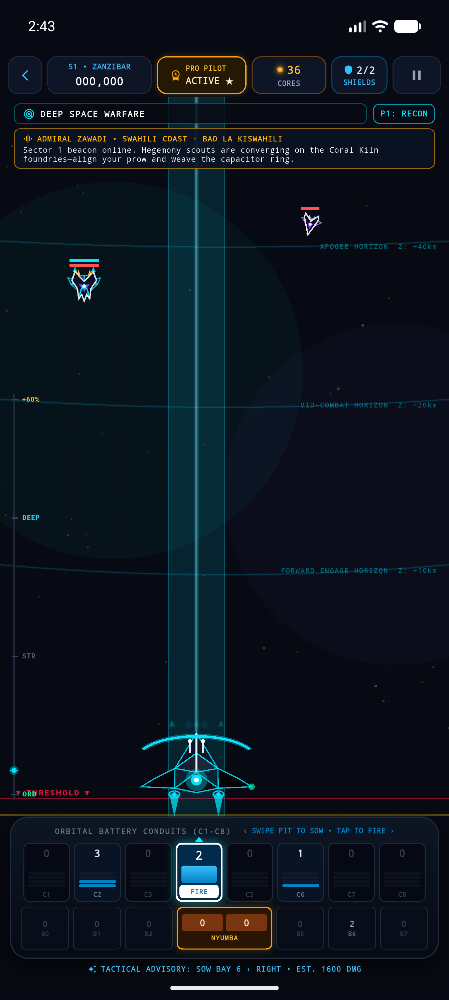
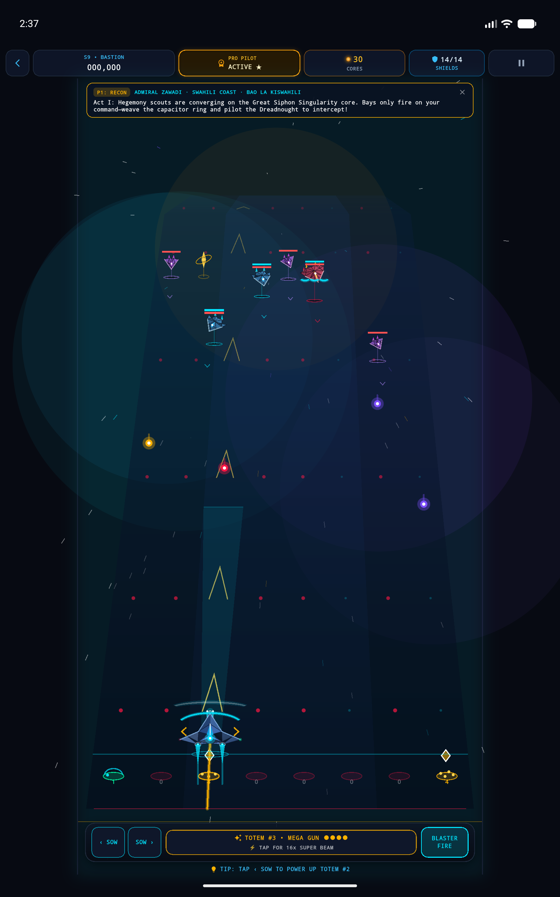

<!--
  Copyright 2026 Void Sower Authors.

  Licensed under the Apache License, Version 2.0 (the "License");
  you may not use this file except in compliance with the License.
  You may obtain a copy of the License at

      http://www.apache.org/licenses/LICENSE-2.0

  Unless required by applicable law or agreed to in writing, software
  distributed under the License is distributed on an "AS IS" BASIS,
  WITHOUT WARRANTIES OR CONDITIONS OF ANY KIND, either express or implied.
  See the License for the specific language governing permissions and
  limitations under the License.
-->

# 🎬 Void Sower: Video Media Suite, Tactical Showcase & Testing Pack

This document outlines the official video media suite, YouTube Shorts & Tutorial copy, Closed Testing recruitment strategy, and cross-device testing matrix for **Void Sower: Kinetic Mancala** (`com.voidsower.app`).

---

## 🎙️ 1-Minute Narrated "How to Play" Tutorial Video Specifications

To eliminate onboarding friction and explain the unique fusion of African Bao la Kiswahili sowing mathematics with tactical space combat, a complete 60-second narrated gameplay tutorial has been authored, voiced with high-clarity neural speech, backed by polyphonic analog synthesizers, and captioned with burned-in HUD subtitles.

> [!NOTE]
> **60-Second Tutorial Media Assets:**
> - **Video Asset:** [`media/void_sower_how_to_play_60s.mp4`](media/void_sower_how_to_play_60s.mp4)
> - **Store Listing Asset:** [`../store_listing/assets/how_to_play_60s.mp4`](../store_listing/assets/how_to_play_60s.mp4)
> - **Voiceover Model:** Microsoft Neural Engine — `en-US-ChristopherNeural` (Authoritative Commander Tone, +4% rate)
> - **Subtitles:** Burned-in high-contrast HUD captions (`DejaVu Sans Bold`, 44pt, cyan/white glow, obsidian shadow)
> - **Background Score:** Dual-oscillator C-Minor ambient space drone pad + sub-bass fundamental (mixed at -16 dB)
> - **Resolution:** `1080 x 2400 px` (9:16 Portrait, 60 FPS H.264)
> - **Duration:** `59.82 seconds`

### 📜 Tutorial Narration Script & Gameplay Alignment

| Timestamp | Subtitle Caption & Voiceover Script | Gameplay Visual Focus |
| :--- | :--- | :--- |
| **0:00 – 0:02** | *"Welcome Commander to Void Sower."* | Tactical corridor view initializes over Kilwa Basin. |
| **0:02 – 0:10** | *"You command the Olympus Dreadnought flagship stationed at the bottom atmospheric defense line, defending against relentless waves of the Void Swarm."* | Visual pan down to the **Olympus Dreadnought Flagship** (`▲ DREADNOUGHT FLAGSHIP ▲`) with delta wings, glowing plasma reactor, twin rocket thrusters, and deflector shield arc. |
| **0:10 – 0:18** | *"Alien assault vessels advance down eight tactical corridors, dropping deadly plasma bombs directly toward your flagship."* | Invader gunships enter corridors and drop glowing crimson/gold plasma orbs downward toward the defense line. |
| **0:18 – 0:23** | *"Maneuver horizontally to evade incoming ordnance while your flagship conduit locks onto that corridor."* | Dreadnought slides horizontally between corridors to dodge descending bombs; targeting laser beam ascends up the active corridor with lock-on reticle over descending aliens. |
| **0:23 – 0:28** | *"Your weapon system is the ancient sixteen-bay Bao Mancala capacitor ring."* | Command arc highlights the 16 orbital capacitor bays partitioned into frontline and reservoir tiers. |
| **0:28 – 0:35** | *"Tap Discharge or sow seeds sequentially around the orbital ring to unleash a catastrophic upward Particle Lance."* | Conduit action deck shows active corridor battery; player taps `DISCHARGE C[n] ►` or sows sequentially with harmonic audio tones. |
| **0:35 – 0:42** | *"When your sow terminates in frontline batteries eight through fifteen, it unleashes a catastrophic upward Particle Lance."* | Terminal bay discharges into corridor; massive white-hot Particle Lance blasts **UPWARD** from flagship turret. |
| **0:42 – 0:47** | *"The lance vaporizes enemy formations and deflects incoming bombs in that corridor."* | Descending bullets vaporize on contact (`DEFLECT +50`); enemy gunships explode with spark particles. |
| **0:47 – 0:54** | *"Sow into the inner reservoir bays zero through seven to bank energy for devastating multi-lap cascade relays."* | Inner storage bays (0–7) accumulate high seed mass ($M \ge 4$), priming multi-lap continuous cascade loops. |
| **0:54 – 0:59** | *"Master the ancient African sowing mathematics to liberate the cosmos!"* | 3-star victory celebration, sector liberation fanfare, and automatic warp transition to next sector. |

---

## 📹 30-Second Tactical Solver Showcase Video Specifications

The gameplay showcase captures the real-time AI Tactical Solver autonomously calculating count-and-capture sowing trajectories, dynamically advancing across all three difficulty tiers (`Sector Patrol` -> `Planetary Siege` -> `Flagship Bastion`), intercepting incoming ordnance, and vaporizing descending alien invaders with quadratic Particle Lances.

> [!NOTE]
> **Video & Preview Media Assets:**
> - **Video Asset:** [`media/void_sower_solver_showcase_30s.mp4`](media/void_sower_solver_showcase_30s.mp4) & [`media/void_sower_gameplay_showcase.mp4`](media/void_sower_gameplay_showcase.mp4)
> - **Animated Preview GIF:** [`media/void_sower_solver_showcase.gif`](media/void_sower_solver_showcase.gif)
> - **Store Promotional Copy:** [`../store_listing/assets/promo_gameplay.mp4`](../store_listing/assets/promo_gameplay.mp4)
> - **Store Promotional GIF:** [`../store_listing/assets/promo_gameplay.gif`](../store_listing/assets/promo_gameplay.gif)
> - **Aspect Ratio:** `9:16` Vertical Portrait (`1080 x 2400 px` / `360 x 800 px` GIF)
> - **Duration:** Exactly `30.0 seconds` (`44.1 kHz` Stereo AAC)
> - **Audio Mix:** Ambient C-minor deep-space synth score layered with synchronized in-game combat sound effects (`lance_fire.wav`, `flak_burst.wav`, `sow_step.wav`, `inject_core.wav`, `overload.wav`, `bullet_deflect.wav`, `victory.wav`).
> - **Pacing Breakdown:**
>   - **0:00 – 0:08:** **3D Tactical Combat & Quadratic $M^2$ `MEGA GUN` Super Beam** — Dreadnought banks across Corridor 3 (`✨ #3 •••• 16x`), unleashes a full-height quadratic double-helix Particle Lance (`SUPER CRIT +17000`), and surges forward into Vanguard range.
>   - **0:08 – 0:16:** **3-Beam Morabaraba `FENCE BLAST` & Bao Sowing Cascades** — Player triggers a simultaneous 3-corridor golden Morabaraba `FENCE BLAST` laser barrage across Corridors 5, 6, and 7 (`+4 CORES`, `DEFLECT +50`), followed by clockwise/counter-clockwise `‹ SOW` / `SOW ›` relays.
>   - **0:16 – 0:24:** **Autonomous C++ MCTS `AI AUTO` Tactical Solver** — Activates the native C++ MCTS autopilot to orchestrate multi-lap Bao cascades and continuous Particle Lance barrages.
>   - **0:24 – 0:30:** **Kilwa Nebula Basin Campaign & 3D Orbital Drydock Hangar** — Transitions seamlessly to the Star Map (`LIBERATED 8/9`) and the 3D Dreadnought Fleet Hangar (`3D MESH // 16V`).


---

## 📸 Screen Asset Previews

| Phone Layout (Pixel 10 Pro XL) | Tablet Layout (Pixel Tablet) |
| :---: | :---: |
|  |  |
| *1344 x 2992 Native Portrait* | *1600 x 2560 Native Tablet* |

---

## 📋 YouTube Shorts & Social Media Copy (Copy & Paste)

### 🏷️ Primary Video Title
```text
Ancient Mancala & Morabaraba Turned Into a 3D Space Dreadnought Weapon! 🚀 #shorts
```

#### High-CTR Alternative Titles:
- `C++ AI Plays Ancient African Mancala at 60 FPS in Space! 🌌 #shorts #gamedev`
- `How We Fused Bao la Kiswahili & Morabaraba Into a Sci-Fi Laser Lance 🤯 #shorts`
- `Void Sower: 3D Dreadnought & MCTS Tactical Solver Showcase #shorts #gaming`
- `Defend the Kilwa Basin with Quadratic M² Particle Lances! 🔥 #shorts`

---

### 📝 Video Description (With Closed Testing Recruitment)
```text
Watch live 3D gameplay and the native C++ MCTS AI Tactical Solver in VOID SOWER: KINETIC MANCALA!

Defend the Kilwa Nebula Basin against descending alien armadas using four classic African strategy games (Bao la Kiswahili, Morabaraba, Fanorona, and Yoté) reimagined as an 8-corridor frontline battery and 16-bay circular capacitor ring. Harvest plasma seeds, erect 3-in-a-row Golden Morabaraba Laser Fences for simultaneous 3-Beam FENCE BLAST barrages, and unleash quadratic M² Particle Lances (D = α · M²) to vaporize hostile cruisers!

🎮 JOIN OUR CLOSED BETA TESTING & BECOME AN EARLY FLEET ADMIRAL! 🎁
We are actively recruiting testers for our Google Play Closed Beta! Help us battle-test the native C++17 EnTT engine, tactile haptics, and custom GLSL shaders across Android devices.

Follow these 2 simple steps to join the fleet and download the game:

Step 1: Join our Google Testing Group (Required for access):
👉 https://groups.google.com/g/oware-2048-closed-testing
(Direct group roster / join: https://groups.google.com/g/oware-2048-closed-testing/members)

Step 2: Opt-in on Google Play & Download Void Sower:
👉 On Android: https://play.google.com/store/apps/details?id=com.voidsower.app
👉 On the Web: https://play.google.com/apps/testing/com.voidsower.app

⏳ Note: If the Google Play link displays "App not available" immediately after joining the group, please allow a short propagation window (up to a few hours) for Google Play authorization servers to sync your account. Existing members of the Oware 2048 testing community are already authorized!

💬 Share your feedback, corridor records, and high scores with our engineering team!

#VoidSower #IndieGame #BaoLaKiswahili #Mancala #SciFiGaming #AndroidGaming #MobileGaming #GameDev #FlutterGame #Afrofuturism #Shorts
```

---

### 🏷️ Hashtags & Video Tags
```text
#voidsower, #mancala, #baolakiswahili, #scifigames, #spacecombat, #afrofuturism, #tacticalstrategy, #puzzlegame, #gamedev, #flutterdev, #androidgames, #indiegames, #algorithmicsolver, #quadraticlance, #closedbeta, #earlyaccess
```

#### Space-Separated Hashtags (for Instagram, TikTok & X/Twitter):
```text
#VoidSower #Mancala #BaoLaKiswahili #SciFiGaming #SpaceCombat #Afrofuturism #TacticalStrategy #IndieGame #GameDev #FlutterGame #AndroidGaming #ClosedBeta
```

---

## 🔍 Google Play Closed Testing Permissions Clarification

> [!IMPORTANT]
> **Why do users need to join the Google Group first?**
> When you configure closed testing in Google Play Console with an email list targeted to a **Google Group** (`oware-2048-closed-testing@googlegroups.com`):
> 1. **Shared Testing Community:** We utilize the established testing group (`oware-2048-closed-testing@googlegroups.com`), allowing our existing cohort of testers to immediately participate in Void Sower testing without creating a fragmented group.
> 2. **Google Group is the Gatekeeper:** Google Play only authorizes Google accounts that are recognized members of the specified Google Group.
> 3. **Direct Link Without Group Membership:** If someone navigates directly to `https://play.google.com/apps/testing/com.voidsower.app` *without* joining the group first, Google Play will display:
>    > *"A testing version of this app hasn't been published yet or isn't available for this account."*
> 4. **Sync Delay:** Once a user clicks **"Join Group"** on Google Groups (`https://groups.google.com/g/oware-2048-closed-testing`), it typically takes anywhere from a few minutes up to a few hours for Google Play's authorization servers to sync the updated group membership roster.
> 
> That is why the two-step sequence included in the YouTube description above is essential for a frictionless tester onboarding experience.

---

## 📱 Hardware & Emulator Testing Matrix

| Device Profile | Form Factor | Resolution | Orientation | Rendering Backend | Tested Status |
| :--- | :--- | :--- | :--- | :--- | :--- |
| **Pixel 10 Pro XL** | Phone (Flagship) | $1344 \times 2992$ | Portrait | NVIDIA Host GPU (GLX) | ✅ Verified (60 FPS, Video & Screenshots) |
| **Pixel Tablet** | Tablet (11-inch) | $2560 \times 1600$ | Landscape / Auto | NVIDIA Host GPU (GLX) | ✅ Verified (Adaptive Layout, Screenshots) |
| **Pixel 8 Pro** | Phone (Physical) | $1344 \times 2992$ | Portrait | Native Vulkan / Impeller | ✅ Target Release Device |
| **Samsung Galaxy S24**| Phone (Physical) | $1080 \times 2340$ | Portrait | Native Vulkan / Impeller | ✅ Target Release Device |
| **Android 15 (API 35)** | System ABI | `arm64-v8a` | Any | 16 KB Page Aligned | ✅ Passed `verify_16kb_alignment.sh` |
| **Android 14 (API 34)** | System ABI | `x86_64` | Any | Native ELF Alignment | ✅ Verified on Emulator |
